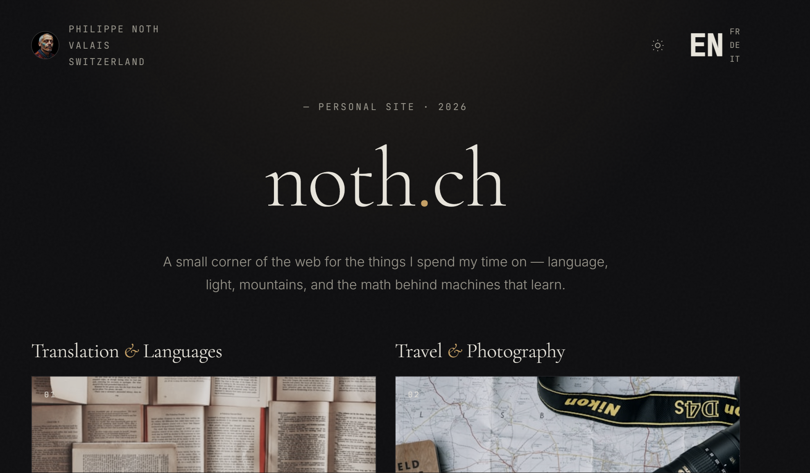
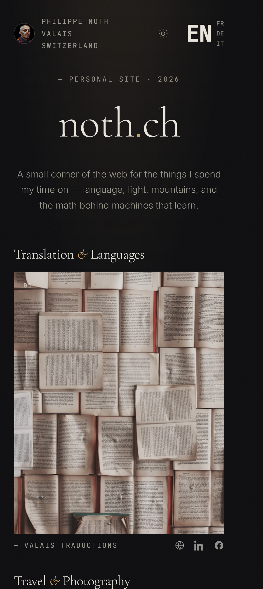
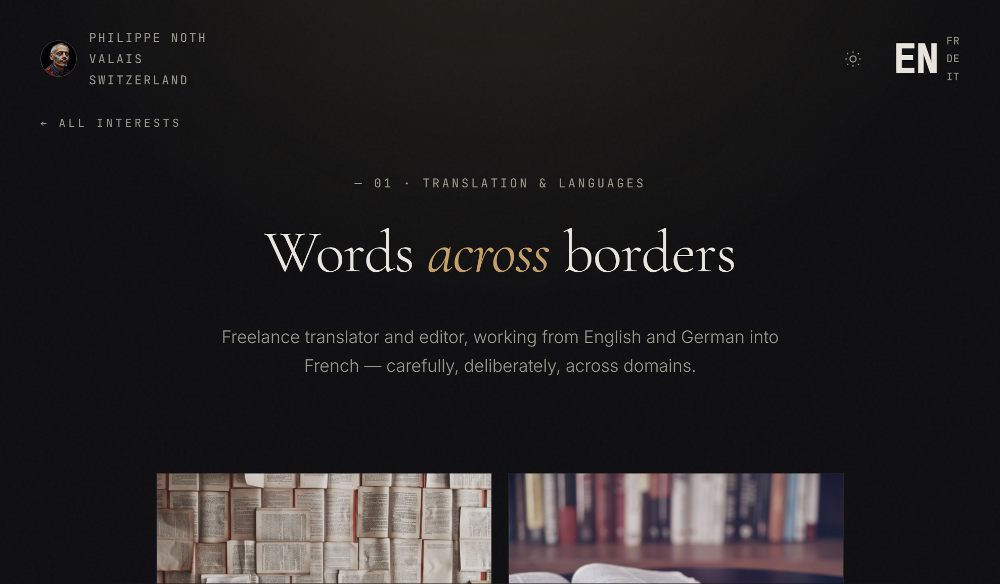

# noth.ch

Personal portfolio site for [Philippe Noth](https://noth.ch) — freelance translator, hiker, photographer, and math enthusiast from Valais, Switzerland.

Static, multilingual (EN / FR / DE / IT), no framework, no build step. Pure HTML and CSS, plus a few lines of inline vanilla JavaScript for the light/dark theme toggle and the Google Analytics snippet.

## Screenshots

<p align="center">
  
</p>

<p align="center">
  
  &nbsp;&nbsp;
  
</p>

## Design

Dark, refined, restrained. Charcoal `#0E0E10` background with a subtle warm glow at the top of the page. Cormorant Garamond serif for the display name and card titles (its italic ampersands are the visual signature), Inter for body, JetBrains Mono for small uppercase labels. A muted brass accent (`#C8A06B`) for the period in `noth.ch`, italic `&` separators, hover states and focus outlines. A warm, light theme (`#F4F1EB`) is available via the toggle in the header.

The full design system (tokens for both themes, type scale, spacing, imagery, motion, and a checklist for new components) is documented in [design-system.md](design-system.md).

## Layout

- The page is a vertical flex column, and the footer is pushed down with `margin-top: auto`.
- The header is a single flex row: the brand on the left (portrait avatar + "Philippe Noth · Valais · Switzerland" in monospace), then the theme toggle and the language switch on the right. In the switch, the current language is set large and the other three are stacked small beside it.
- The card grid uses **CSS Grid**: 1 column on mobile, 2 from 640 px, 4 from 1024 px.
- Each card spans three grid rows with `grid-template-rows: subgrid`, so titles, images and footers (company name + social icons) line up across all four cards even when titles have different lengths.
- The footer row is stacked vertically on mobile and becomes a horizontal row from 640 px.

## Structure

```
/
├── index.html              # English homepage at the root (fallback when the .htaccess redirect doesn't apply)
├── .htaccess               # Apache language redirect (Accept-Language → /fr/, /de/, /it/, else /en/) + 404
├── 404.html
├── design-system.md        # Design reference (tokens, type, spacing, motion)
├── CLAUDE.md / AGENTS.md   # Guidance for AI coding agents
├── FAQ.md                  # Notes on assets, images, WebP
├── assets/
│   └── favicon.svg
├── css/
│   └── style.css           # The single stylesheet
├── js/
│   └── script.js           # Empty placeholder; the theme toggle is inline in each page
├── images/                 # Portrait, card images, book covers
├── en/  fr/  de/  it/      # One folder per language, mirrored content
│   ├── index.html
│   ├── translation_languages.html
│   ├── travel_photography.html
│   ├── hiking_nature.html
│   └── ai_it_mathematics.html
└── docs/
    └── screenshots/        # Screenshots for this README
```

## Running locally

No build pipeline. Any static file server works:

```powershell
# Python
python -m http.server 8080

# Node
npx serve .
```

Then open <http://localhost:8080>. Local servers ignore `.htaccess`, so the root shows the English `index.html`; the language pages are under `/en/`, `/fr/`, `/de/` and `/it/`.

## Design touches

- Images sit at 35 % grayscale and are slightly dimmed by default. On hover the photo restores to full color, scales up gently, and the card frame border warms to brass.
- Subtle film grain across the whole page (SVG noise filter, `mix-blend-mode: screen`).
- Numbered cards (01–04) with monospace labels, placed in the top-left corner of each image.
- Staggered entrance animations (title, intro, then the four cards), disabled under `prefers-reduced-motion`.
- Hover underline animation on footer, navigation and language links.
- The portrait avatar in the header scales to 2.6× on hover, with a soft drop shadow.
- The light/dark choice is saved in `localStorage` and applied before the first paint, so there is no flash on page load.
- Pure-CSS tooltips on the social icons.

## Responsive breakpoints

Mobile-first `min-width` breakpoints at 640 / 768 / 1024 / 1280 px. They widen the side gutters (24 → 40 → 64 px), scale the display title, and change the card grid from 1 to 2 to 4 columns.

## Deployment

Any static host works. The included `.htaccess` handles browser-language redirection on Apache. For Netlify / Cloudflare Pages / Vercel, translate the rules to a `_redirects` file.

## License

MIT for the source code. Personal content (photos, portrait, prose, the *noth.ch* name) © 2026 Philippe Noth, all rights reserved. See [LICENSE](LICENSE).
